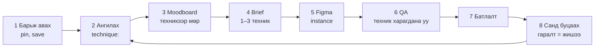

# 🧭 Creative workflow v2 — техникээр сэтгэх тойрог

**Тэнхлэг:** `workflow:` · @mention: `@creative-technique-loop` · техникийн сан: [[04-Resources/Taxonomy/Technique]]

## For future agent
{{fm:member}} 2026-10-29: «Creative agentийг маш хүчтэй болгомоор байна. Миний moodboard дээр ажиллаж буй зарчим нь сүүлдээ хөгжөөд энэ бичлэг дээр гарч байгаа шиг ажлын урсгалтай болмоор байна» (бичлэг = IRIS, [[04-Resources/references/2026-10-29 - IRIS - дүрсийг механизмаар нь ангилах таксономи]]). v1 нь «гоё зураг цуглуулах → moodboard → зурах» байсан; v2-т асуулт нь **«энэ зураг ямар механизмаар ажиллаж байна вэ»** болж, сан нь өөрсдийн гаралтаас өснө.

## Тойрог

## Алхам бүрийн дүрэм
1. **Барьж авах.** Pin, social save, лавлагаа cover-тайгаа vault-д орно ([[03-Areas/Studio/Social saves/Social saves]], `04-Resources/references`). Эхлээд vault-аас хайна, байгааг дахин татахгүй.
2. **Механизмаар ангилах.** Creative cover-ыг нүдээр харж `technique:`-д 1–3 утга тавина; эргэлзвэл хоосон. AI таасан бол `technique-evidence: inferred`. Шинэ техник = ≥4 бодит жишээтэй үед л `Technique/`-д шинэ note (тодорхойлолт, үйлдэл › талбар, хэзээ хэрэглэх/болохгүй).
3. **Moodboard = техникээр бүлэглэсэн.** Figma «🖼 Moodboards»-д төслийн section; мөр бүр нэг техник — зүүн талд `Technique/Header` instance, баруун талд pin-ийн **clone** (эхийг засахгүй). Харагдах байдлаар («dark», «minimal»), сэдвээр бүлэглэхгүй. Vault-д `Gallery.base` → «🧭 Техникээр».
4. **Brief = «ямар алхам тус болох вэ».** Гаралт бүрд: юу хийх гэж байна (үйлдэл: ялгах / бүлэглэх / дараалуулах / таамаглуулах) → юугаар (талбар) → **1–3 техник**. Жишээ: «Carousel нүүр — ялгах: Масштабын зөрүү + Ханасан өнгөн талбай; дотор слайд — дараалуулах: Хэмжээний шатлал». 3-аас олон техник = чиглэлгүй.
5. **Гүйцэтгэл.** Figma-д component instance-аар (`fm:post`, `fm:figma`), wrap grid, засвар бүр clone. Техник нь layout-ын шийдвэр — нэрлэсэн техникийг frame-ийн нэр эсвэл тайлбар дээр бичнэ.
6. **QA.** Техник бүрийг тусад нь: 360 px thumbnail дээр нүдэнд харагдаж байна уу (техникийн note-ийн «Brief ба QA-д»)? Дээр нь contrast (`contrast_check.js`), давхцал (`check_layout.js`), `creative_check.js`, Design test. Харагдахгүй техник = биелээгүй, засна.
7. **Батлалт.** {{fm:member}} Figma коммент-оор; батлагдсан frame түгжигдэнэ.
8. **Санд буцаах.** Output note-д `technique:` + `technique-evidence: observed`; Figma «🧭 Техникийн сан»-гийн тухайн мөрөнд leaf болж нэмэгдэнэ. Ингэснээр сан өөрсдийн ажлаар өсөж, дараагийн brief-д «бид өөрсдөө үүнийг яаж хийсэн бэ» гэсэн жишээ болно.

## Хэн юу хийх
| Алхам | 🎨 Creative agent | {{fm:member}} |
|---|---|---|
| Барьж авах | Харвестер, `fm:save`-ээр cover-той note | Pin, save хийнэ |
| Ангилах | Cover-ыг харж `technique:` тавина, шинэ техник санал болгоно | Шинэ техник, нэрийг батална |
| Moodboard | Техникээр мөр зурж clone тавина | Аль мөрийг ашиглахыг коммент-оор |
| Brief | 1–3 техникийн санал (A/B) | **Сонгоно** (батлах цэг) |
| Гүйцэтгэл, QA | Зурна, шалгана, олдвороо `review`-ээр | — |
| Батлалт | Түгжинэ, Output note | **Батална** |
| Санд буцаах | `technique:`, Figma leaf, лог | — |

## Гаралт
- `technique:`-тэй лавлагаа ба gallery note
- техникээр бүлэглэсэн Figma moodboard
- brief дахь 1–3 техник, QA-ийн техникийн мөр
- `technique:`-тэй Output note (сангийн шинэ жишээ)

## Дуудах
Task-д `workflow: creative-technique-loop`, чатад `@creative-technique-loop`.
